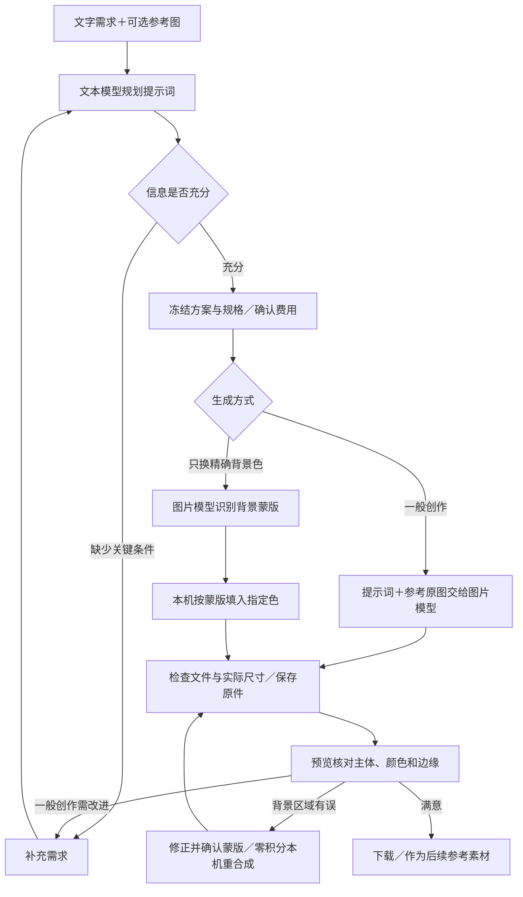
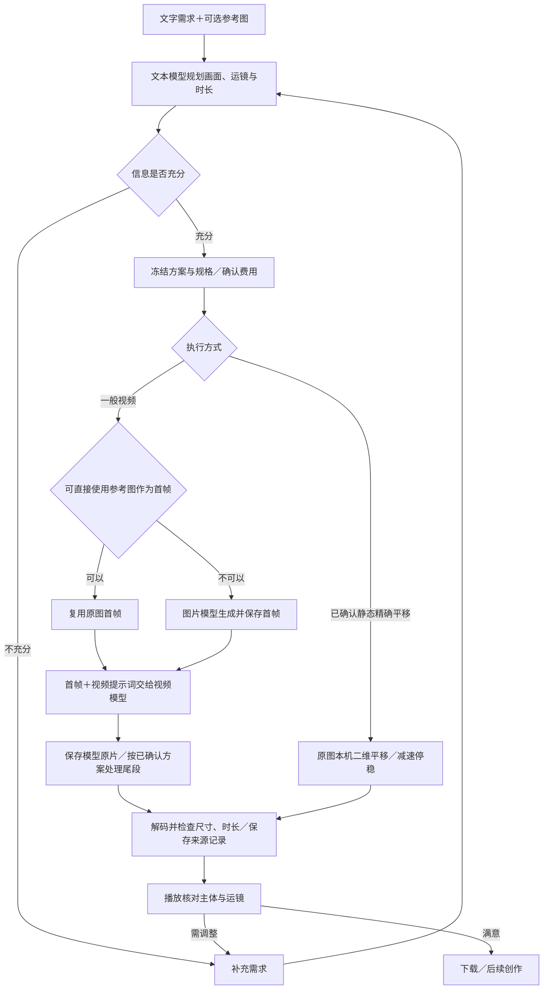

# 原生生图与生视频闭环

按当前实现整理；通用创作已在项目内编排，不依赖 Dify（工作流平台）。专用工具仍使用各自适配器，不能以这两条主链概括整个平台。

## 生图

文本规划当前读取需求与素材编号、实测尺寸等元数据，并未把参考图像素发送给文本模型。图片模型收到实际参考原图。一般生成的参考约束不等于像素锁定；精确换背景则以蒙版保护区保留原图像素，蒙版仍需核对。

## 生视频

- 首帧可复用时不必先重新生图，能避免不必要的主体变化。
- 本机精确平移只适用明确静止主体、允许边缘裁切、1%～3%水平位移且不需要三维视差的已确认需求；它不是视频模型生成的动态场景。
- 固定中心微变焦的尾段处理先保留完整模型原片，再顺序压缩运动时段并保持末帧半秒。它可以修正停稳时间，不能修复模型已生成的几何形变。
- 图中的“核对”是用户预览和本轮人工验收；产品没有自动主体一致性、蒙版语义或运镜质量评分。不能把文件检查画成视觉质量自动通过。

## 失败与恢复

明确未受理或失败：释放未结算的预留积分。创建结果未知、文件落盘或规格异常：进入待核对，保留必要预留，不自动重复付费生成。已有远端任务继续查询原任务；首帧、蒙版、模型原片和已缓存文件可复用恢复。明确重试需要重新估价，平台积分与供应商余额分开计算。
