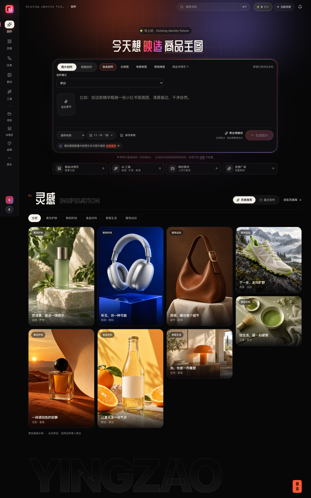

# 第一阶段项目审查与优化

日期：2026年11月13日。**本轮已完成下列缺陷修复与工程检查，但主题项曾被我们误判并改动了既定深色主风格，违反项目设计约定。原主题结论已撤回，现已恢复原深色主风格，主题与相关语言28／28回归通过。** 详见[主题误判纠正记录](THEME-CORRECTION.md)。真实商业能力的未验项继续保留。

本轮从界面布局、视觉一致性、设计细节、交互、功能流程和代码质量六方面检查当前实现。原本应保持现有深色创作风格；我们却把设置标签“跟随系统”当作跟随操作系统的需求，忽略了设计文档和本轮源码基线中“该选项也使用深色”的明确约定。该行为不是产品原有缺陷，是本轮审查引入的越界改动。

## 问题与修复

| 范围 | 发现的问题 | 处理 |
| --- | --- | --- |
| 布局 | 1280×720、1024×600短屏的账户与空间入口落在屏幕外，侧栏无法滚动。 | 侧栏独立滚动；实际打开两个面板验证可用。 |
| 布局 | 手机抽屉宽度加外边距后越出屏幕10像素。 | 宽度扣除左右边距，验证320／390／768像素。 |
| 视觉一致性 | 渐变按钮白字对比不足，多个入口分别使用颜色。 | 集中使用独立操作渐变，保留装饰品牌渐变；深浅主题和悬停分别测量。 |
| 设计细节 | 首页提示文字叠加透明度及延迟样式覆盖，深浅主题对比度仅3.24／2.72。 | 统一实体文字颜色和不透明度，单独核对说明文字，避免无依据地整体改色。 |
| 主题审查误判 | 错把既定的“默认及旧系统选项均为品牌深色”认定为缺陷，改成跟随操作系统；已有账户可能因此变浅。 | 撤回原缺陷与修复结论，恢复品牌深色约定并澄清设置标签；纠正后主题与相关语言28／28通过，当前演示首页已实见深色。 |
| 视觉一致性 | 任务筛选与工具分类仍使用不同矩形圆角，选中态也会被旧悬停规则覆盖。 | 统一胶囊与反色选中态，实际点击核对筛选结果、焦点和选中语义。 |
| 登录交互 | 点击“忘记密码”只改变地址，不切换页面。 | 页面选择订阅路由状态，验证点击、返回和浏览器后退。 |
| 错误恢复 | 服务暂不可用后重试遇到登录过期，仍停在旧错误页。 | 清除过时错误，恢复登录，再核对实际登录成功。 |
| 素材集合 | 加入素材会清除同集合中回收站素材的归属。 | 改为事务内增量修改，恢复素材后关联仍在。 |
| 素材集合 | 同时编辑时整包覆盖其他客户端新增内容。 | 仅传明确增删项，保留其他成员；保持500个总成员上限与权限边界。 |
| 状态反馈 | 集合读取失败误报“请先创建集合”。 | 区分加载、错误与空结果，提供重试并防止错误操作。 |
| 草稿恢复 | 工具素材尚未恢复完成就解锁表单，迟到结果可能覆盖用户新选择。 | 素材恢复期间禁止编辑并标记忙碌，验证换图、保存和重新打开。 |
| 表单细节 | 新建集合允许120字，服务端只接受80字。 | 输入约束与服务端保持一致。 |
| 代码质量 | 供应商请求出错或响应过大时未释放响应资源。 | 拒绝时取消正文，读取器始终释放，保持提交不确定的恢复语义。 |

详细依据见[界面审查](UI.md)、[流程审查](FLOWS.md)、[代码审查](CODE.md)。修复前失败、测试环境失败与修复后通过分开保存。

## 验证记录

以下保留主题纠正前的实际检查历史，不抹去原测试结果。其中主题用例采用了错误需求，虽然通过，也不能证明符合产品设计；纠正后的检查结果由[主题纠正记录](THEME-CORRECTION.md)另行补充。

- 初始类型与规范检查通过；初始完整单元／集成测试2248／2249通过，1项大输入子进程超时已单独定位。
- 超时发生在测试程序读取标准输入时，尚未运行工作流。改为私有临时文件描述符传递相同输入，维持10秒限制并自动清理；工作流源码未变。
- 最终完整单元／集成测试 **147个文件、2265／2265通过**，使用环境白名单；测试配置同时关闭构建工具和应用模块对本机环境文件的自动读取。合成环境文件黑盒回归先失败后通过。
- 完整浏览器基线 **392／392通过**，覆盖桌面、手机模拟、笔记本与平板；无跳过、无用例重试，392份诊断均无未捕获异常。
- 后续统一构建关联回归 **166／168通过**。两项失败均为新测试错误要求手机显示桌面专有说明，实际颜色对比度已达标；修正可见项断言后，桌面／手机占位提示 **4／4通过**。最终筛选与占位联合复测 **8／8通过**。
- 全量运行使用固定前端构建，后续主题、占位提示、集合边界与筛选样式改动分别有增量证据；不累加重复用例，不宣称最终版本单次跑完全部浏览器用例。此前主题增量证据仅证明错误实现符合当时写错的断言，不能作为深色主风格验收。
- 最终类型、代码规范、格式检查及前后端生产构建通过；构建候选在空白临时数据库启动，校验页面资源、首次注册、安全会话、服务端与执行器共同迁移和进程清理。真实运行入口未重启。

| 证据 | 位置 |
| --- | --- |
| 单元／集成最终日志 | [最终测试](unit-final.log) |
| 完整浏览器基线 | [运行日志](e2e-full.log)；`platform/var/e2e/run-D8W7sR/report/index.html`（本机报告） |
| 统一构建关联回归及两项断言失败 | [运行日志](e2e-final-increment.log)；`platform/var/e2e/run-nASGst/report/index.html`（本机报告） |
| 占位提示断言修正后 | [运行日志](placeholder-final.log)；`platform/var/e2e/run-TppNNE/report/index.html`（本机报告） |
| 筛选与占位最终8项 | `platform/var/e2e/run-Sxs0iv/report/index.html`（本机报告） |
| 生产构建／隔离运行 | [构建日志](build-final.log)、[最终网页构建](build-web-final.log)、[运行检查](runtime-final.log) |
| 可审阅源码差异 | [变更补丁](changes.patch)、[变更清单](change-manifest.json) |

## 截图

以下是隔离账户与公开示例，未使用正式私有媒体。

[浅色首页](screenshots/home-light-desktop.png) · [手机抽屉](screenshots/notification-drawer-mobile.png) · [短屏账户入口](screenshots/short-screen-account.png)

## 范围与交付边界

- 所有业务验收使用独立数据库与本机模拟服务；未使用真实凭据调用外部服务、修改正式数据库或消费模型额度。本轮没有证明外部模型的新成品质量。
- 真实支付、开票、外部身份与通知，以及功能台账中其他未验项仍未通过本轮商业验收。视频真实创建继续保持此前暂停状态。
- 现有大组件和多层样式仍有维护成本；首屏入口包约935千字节，压缩传输约301千字节，构建仍有体积提示。尚未验证低端设备的加载性能，后续应先测量再拆分；本轮没有靠提高告警阈值或机械分包掩盖问题。
- 其他修复已写入本地源码，先前构建候选位于 `platform/var/project-audit-20261113/candidate`（隔离候选）；主题纠正后的隔离网页构建与28项回归见主题纠正记录，当前演示网页已热更新为深色。正在运行的正式后端需要在下一次按原方式重启时加载修复；本轮不重启正式服务或处理其队列。
- 当前目录没有版本控制元数据；修复前584份源码、测试及配置摘要保存在 `baseline-sha256.json`（基线摘要），源码备份在 `/tmp/yingzao-project-audit-20261113-baseline.tar.gz`（本机备份）。无提交、推送或部署动作。
- 使用现有本地工具完成检查。依赖安装元数据仍指向旧工作区，严格包管理器会要求重新安装；没有关闭该检查。浏览器验收使用已安装的Chrome（浏览器），没有下载或更新依赖。
