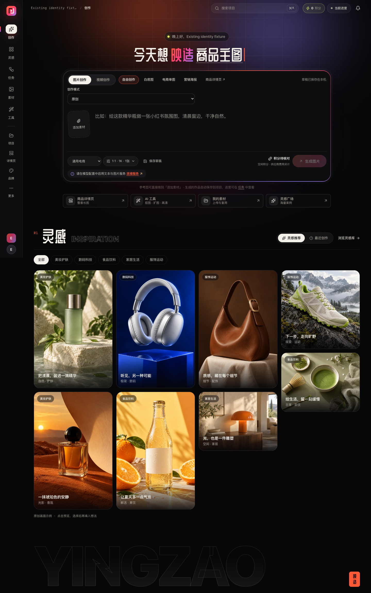

# 主题审查误判纠正记录

日期：2026年11月13日。状态：**原错误结论已撤回；已恢复原深色主风格并通过本次回归。**

## 误判与影响

本轮把“跟随系统选项仍使用深色”认定为缺陷，继而让 `system`（历史主题值）随操作系统切换深浅色。该判断错误，违反了已有设计文档和保持深色主风格的任务范围。用户指出问题后，我们撤回了这一结论。不是用户新增了相反设计要求，而是我们没有遵守原有约定。

仅把新账户缺省改为 `dark`（深色）不能补救该问题：已有账户和演示账户可能保存 `system`（历史主题值），在操作系统浅色时仍会被错误改成浅色。未迁移正式数据库也不等于未改变用户看到的界面。

## 核实依据

- [设计系统](../../设计系统.md)第29行明确：“深色为默认主题（‘跟随系统’也使用深色），浅色为用户手动选择的备选主题。”
- 本轮接手备份 `/tmp/yingzao-project-audit-20261113-baseline.tar.gz`（源码基线归档）中的 `platform/src/web/context.tsx`（应用上下文）明确注释品牌默认深色，并实现 `theme === 'system' ? 'dark' : theme`（历史系统值映射为深色，其他显式选择照常生效）。
- 接手备份与当前 `platform/scripts/seed-demo.ts`（演示数据脚本）都为演示账户保存 `theme: 'system'`（历史主题值），因此错误的新映射确实会影响演示账户效果。
- 更早的 `_ui-backup-20261110/web/context.tsx`（旧界面备份）仍是跟随操作系统的实现。它属于较早历史版本，与本轮接手基线不同，不能用于覆盖当前明确的设计约定。
- 本轮曾加入操作系统颜色偏好监听，按系统浅色设置页面浅色。原浏览器测试也以此为目标，所以测试通过没有发现范围越界。

## 纠正范围

- 恢复品牌深色主风格：默认、新账户、缺主题字段的旧账户及历史系统值都保持深色，操作系统变化不自动改色。
- 保留用户明确选择浅色或深色的现有能力；将历史系统选项的界面标签澄清为品牌默认含义。
- 不迁移或改写正式账户偏好，不重新设计深浅配色，不扩大其他已验证修复的范围。
- 重写主题回归的需求断言，核验已有系统值、缺失字段、新账户、显式选择及刷新后的效果；保留旧失败报告、旧8项通过报告和对应截图作为错误判断的历史记录。

## 验收状态

- 应用上下文恢复只有用户显式选择浅色才显示浅色，删除操作系统颜色偏好监听；设置标签改为“默认（深色）”，补齐英语与阿拉伯语。
- 修复前按正确约定运行旧账户用例：预期深色、实际浅色，真实失败证据保留在 `platform/var/e2e/theme-brand-baseline-oi4CF7/report/index.html`（本机报告）。
- 当前正在运行的演示首页已通过浏览器实际核对：主题属性为深色，页面背景为 `rgb(7, 7, 8)`（近黑色）；没有保存或改写账户偏好，没有重启服务。
- 类型检查、三个修改源码及主题用例的代码规范和格式检查通过。
- 桌面与手机主题8项、相关语言20项，共28／28通过，零失败、零重试；报告在 `platform/var/e2e/theme-brand-corrected-cK5mMW/report/index.html`（本机报告）。对应隔离网页生产构建通过，原有包体积提示保留。
- 首页截图补跑同一旧账户用例1／1通过，不重复加总。截图只使用合成账户；最终测试截图改存各用例隔离目录，避免后续运行覆盖历史评审产物。
- [主题修正补丁](theme-correction.patch)保留这次三个源码文件的增量；此前摘要、补丁和测试报告保留为纠正前的历史快照。

纠正前的2265项单元／集成检查、392项浏览器基线及主题8项历史通过，不替代本次纠正验收。此次不改业务实现与数据库，不重复宣称业务全量检查。

