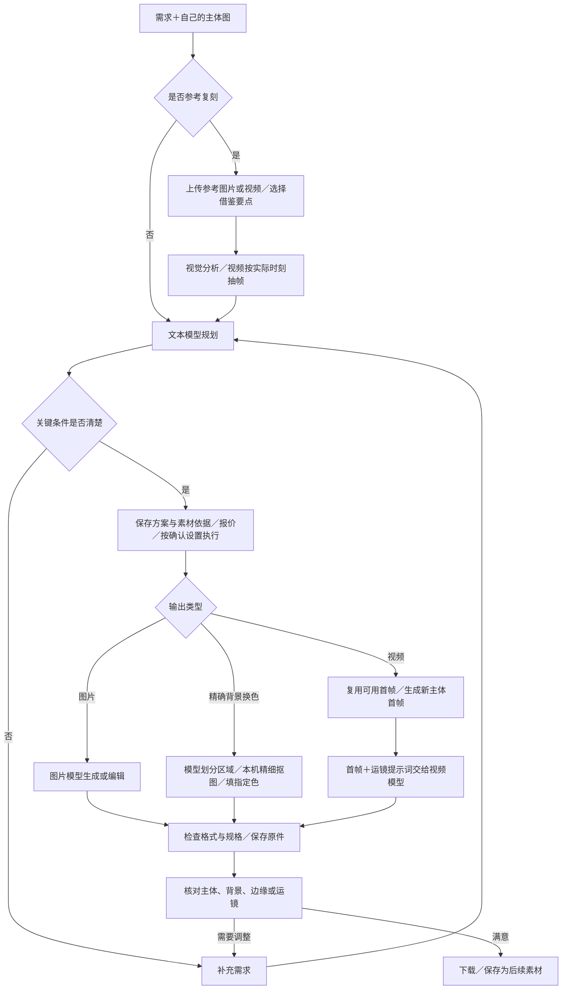

# 当前图片与视频链路

通用生图、生视频和参考复刻由项目内直接编排。文本规划负责明确需求，视觉模型负责读取参考画面；两者可配置为不同模型。

2026年11月13日逐节点核对：本页是主干概览。普通创作没有统一视觉前置；复刻先视觉再文本，精确背景先文本再按配置做视觉分析。普通入口的二次确认受用户设置控制，复刻强制确认；首帧后没有独立确认门。完整实际顺序和每个节点原文见[当前链路与提示词核对](../prompt-chain-20261113/README.md)。

- 图片复刻：先看懂参考，再把构图、布光和配色转成方案；新策略仅将自己的主体图交给图片模型编辑。已确认旧方案沿用其原输入方式。
- 视频复刻：参考选段只作有限抽帧分析，不含音频；新场景首帧和运镜方案再交给视频模型，不直接上传整段参考视频。当前按用户要求暂停真实视频创建，真实分析通过不等于真实复刻成片通过。
- 精确背景色：先识别可改区域、保留表面和真实孔洞，再生成区域蒙版；本机结合原图分割、细化边缘并在线性光下填色合成。只有视觉确认外部背景连续、没有内部背景孔洞且保留表面存在柔焦边缘，才启用场景羽化；杯柄和叶缝继续保留独立背景区域。原图、模型蒙版、最终蒙版及自动合成图均保存。
- 自动结果仍须核对：纯背景色正确不代表主体、孔洞和软边正确；场景羽化是边界估计，不能从单张低对比照片证明真实透明度。人工蒙版为可选调整方式，不计入自动通过；反复调整固定沿用同一自动合成原件，避免累计变色。
- 图中的质量核对是预览及实际验收，不是已实现的自动美学／身份打分。格式检查只能证明文件有效。
- 已有首帧、蒙版和远端任务会保存并复用；结果未知时进入待核对，不自动重复付费提交。明确重做需新方案与报价，平台积分和供应商余额分别计算。
- 本机抠图安装或版本不符时，在请求付费蒙版前停止；已有付费蒙版的本机处理失败或取消只允许显式恢复，不重新请求图片模型。

已有本机精确平移仅在用户明确接受静态主体、少量背景裁切及受限位移时启用，不等同于视频模型生成。已有模型尾段停稳处理保留原片，也不能修复模型已造成的主体形变。
